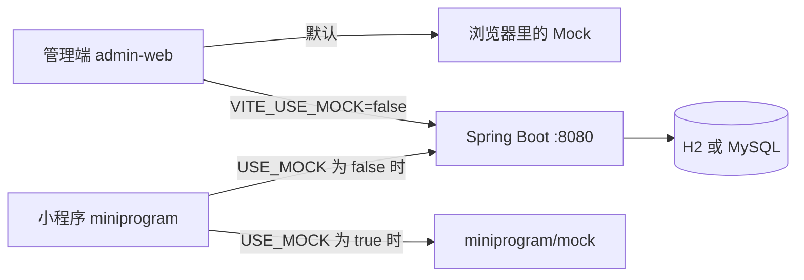
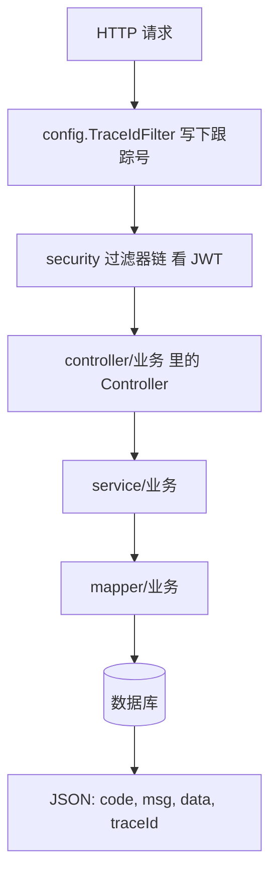
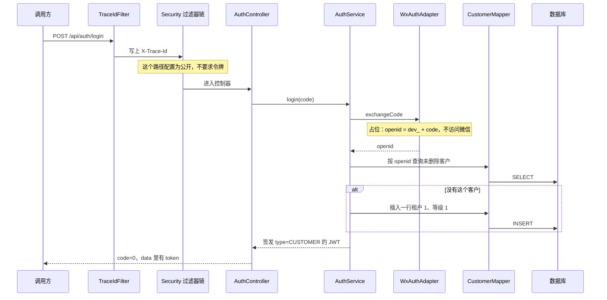

# 代码导读（初学者版）

这份说明给刚接触本仓库的人。你需要会看 Java 或 JavaScript 的基本语法。Spring Boot、Vue、JWT 这些词，下面会按这个仓库里**已经写出来的行为**解释，不把设计文档里的规划说成已经完成。

更完整的选型和表设计在 `docs/02-技术架构与数据库设计.md`。管理端每个按钮对应哪条路径，在 `admin-web/README.md`。

## 1. 这个系统是什么

目标是缝纫机经销商用的一套程序：

- **微信小程序**（`miniprogram/`）：客户看商品、下单、报修。代码是微信原生小程序，不是 Vue。
- **商家 Web 管理端**（`admin-web/`）：员工处理订单、报修、派师傅、登记收款。Vue 3 + Vite + TypeScript。
- **一个 Spring Boot 后端**（仓库根目录的 `pom.xml` 和 `src/`）：两边将来共用它和同一套数据库。

现在的实现程度不一样：

| 部分 | 现在实际能做什么 |
| --- | --- |
| 后端 | 骨架。客户登录、绑定设备、商品空列表、探活可以跑。订单、支付、报修、员工登录的 Java 类还没写，但 Flyway 已经建了其中一部分表。 |
| 管理端 | 页面能点通。默认不访问 Java，数据在浏览器内存里的 Mock。 |
| 小程序 | 有页面和请求封装。登录会打到后端的占位接口；很多业务路径后端还没有。 |



默认启动后端时，数据库是进程内的 H2，停掉程序数据就没了。不是两个前端各有一个库。

## 2. 后端的分层：请求怎么往下走

可以把它想成一条流水线。包名在 `src/main/java/com/zhongbang/controller/` 下面。



一次业务请求进了安全过滤器之后，按包名往下走四步。顶层先按这四层分，每一层里面再用同一个业务名建子包。例如客户设备是 `controller.customer` → `service.customer` → `mapper.customer`，用到的对象在 `pojo.customer`。

1. **`controller/<业务>`**：HTTP 入口。接收路径和 JSON，调用同名 Service，把结果放进 `{code, msg, data, traceId}`。这里不写「能不能绑定这台设备」。
2. **`service/<业务>`**：业务规则。例如登录时没有客户就插入一行。要读写表时调用 Mapper。现在的 `AuthService`、`AssetService` 直接放在业务子包里。以后若拆成接口和实现，实现类放在 `service/<业务>/impl`。
3. **`mapper/<业务>`**：对一张表的接口。你不写实现类，MyBatis-Plus 按方法生成 SQL，打到 H2 或 MySQL。启动类上的 `@MapperScan("com.zhongbang.controller.mapper")` 会扫到本包和它的业务子包。
4. **数据库**：Mapper 发出的 SQL 落在这里。表对应的 Java 对象不在 Mapper 里，而在 `pojo/<业务>/entity`。请求体在 `pojo/<业务>/dto`，返回给页面的字段也可以放 `vo`。这些类只装数据，自己不访问数据库。

登录没有自己的 Mapper：`service.auth` 写的是客户表，所以它调用 `mapper.customer.CustomerMapper`，客户对象在 `pojo.customer.entity`。

| 包 | 干什么 |
| --- | --- |
| `controller` | HTTP 入口，下面按业务再分。有类的是 auth、customer、product、system。 |
| `service` | 业务规则。有类的是 auth、customer。 |
| `mapper` | 表访问。有类的是 customer。启动时从这里扫描 `@Mapper`。 |
| `pojo` | 实体、请求体、返回字段。有类的是 auth（dto）和 customer（entity、dto）。 |
| `config` | 启动时的开关：跨域、分页插件、用内存还是 Redis。不写「能不能下单」。 |
| `security` | 无状态登录。令牌是 JWT，服务器不存 Session。三种人：客户、员工、师傅。 |
| `common` | 统一 JSON、错误码、跟踪号。 |
| `adapter` | 微信、存储、距离的外层。微信登录是占位，不访问微信服务器。 |
| `support` | 幂等、锁、发消息。Bean 会创建，但没有业务代码调用。 |
| `job` | 定时任务占位，里面没有类。 |

`order`、`payment`、`workorder`、`aftersale`、`technician`、`notice`、`report` 还没有类。这 7 个业务在 `controller`、`service`、`mapper`、`pojo` 下各有一个同名子包，里面只有 `package-info.java`。`security`、`config`、`common`、`adapter`、`support`、`job` 保持原来的位置，不按业务拆开。

每个目录有一个 `package-info.java`，用中文写了这一层或这个业务包是干什么的。类上的注释写了谁调用它、它调用谁。

后端源码目录：

```text
src/main/java/com/zhongbang/controller
├── ZhongbangControllerApplication.java
├── controller/                 HTTP 入口
│   ├── auth/                   客户登录
│   ├── customer/               设备档案
│   ├── product/                商品空列表
│   ├── system/                 探活
│   └── order、payment、…       只有 package-info
├── service/
│   ├── auth/                   AuthService
│   ├── customer/               AssetService
│   └── （未实现业务同上，只有说明）
├── mapper/
│   └── customer/               CustomerMapper、CustomerAssetMapper
├── pojo/
│   ├── auth/dto/               LoginRequest、LoginResponse
│   └── customer/
│       ├── entity/             Customer、CustomerAsset
│       └── dto/                绑定请求、设备卡片
├── common/                     统一响应、错误码、TraceId
├── config/                     Web / MyBatis / 基础设施开关
├── security/                   JWT、三角色、过滤器
├── support/                    幂等、分布式锁、消息发布
├── adapter/                    wx / oss / map
└── job/                        定时任务占位
```

### 几个注解，用这个仓库里的例子

- `@SpringBootApplication`（启动类）：从这里扫描子包，并按依赖自动配置 Web、数据库。
- `@RestController`：这个类的方法返回 JSON，不是网页。例如 `AuthController`。
- `@Service`：业务类，例如 `AuthService`。和 `@Component` 一样会被放进容器，别人可以在构造器里要到它。
- `@Configuration` + `@Bean`：用来声明「容器里放哪个对象」。`InfrastructureAutoConfig` 按 yml 决定放内存实现还是 Redis 实现。
- `@Transactional`：这个方法里的数据库操作要么一起成功，要么一起撤销。`AuthService.login` 上有，因为可能会插入客户。
- `@Mapper`：MyBatis 的表访问接口。你不写实现类，启动时生成。`CustomerMapper` 就是这样。
- JWT 过滤器：每个请求看有没有 `Authorization: Bearer` 开头的头。能解析就把用户放进上下文；解析失败就当没登录，继续往下，不在过滤器里直接报 500。

## 3. 例子：客户登录，从请求到数据库再返回

这条路径是**真的会写数据库**的。管理端登录不是这条，见下一节。

小程序 `app.js` 启动时调用 `wx.login` 拿到 code，再 `POST /api/auth/login`，请求体是 `{"code":"demo"}`。你也可以用 curl 打同样的地址。`AuthController` 在 `controller.auth`，`AuthService` 在 `service.auth`，请求和响应在 `pojo.auth.dto`。查客户用的 `CustomerMapper` 在 `mapper.customer`，因为登录写的是客户表。



返回大致是：

```json
{
  "code": 0,
  "msg": "ok",
  "data": {
    "token": "……",
    "expiresIn": 2592000,
    "hasMobile": false,
    "customer": { "id": 123, "nickname": "", "level": 1, "levelText": "普通客户" }
  },
  "traceId": "……"
}
```

`code` 是业务码，0 表示成功。它不是 HTTP 状态码。未登录的业务码是 2001，HTTP 状态才是 401。

同一个 code 再登录一次，会查到刚才那一行，不会插入第二行（`openid` 有唯一索引）。

`POST /api/auth/phone` 能打到控制器，但方法里直接抛错：「手机号绑定尚未实现」。没有解密，也没有合并客户。

拿到 token 之后，访问设备要带请求头 `Authorization: Bearer` 加这串 token。`GET /api/assets` 只返回这个客户的设备。`POST /api/assets/bind` 按序列号绑定：不查出厂记录，没有就插入机型为「待完善机型」、保修两年的占位行；序列号已经属于别人则业务码 4090。

## 4. 例子：管理端登录和订单列表

管理端**默认不走上面那条链路**。

`admin-web/src/config.ts` 里，`VITE_USE_MOCK` 不是字符串 `false` 就使用 Mock。`src/api/http.ts` 发现要 Mock 时，调用 `src/mock/handle.ts`，数据在 `src/mock/db.ts` 的内存里。刷新页面会回到种子数据。

登录页提交账号密码：

1. `stores/session.ts` 的 `login` 调用 `POST /api/auth/staff/login`。
2. Mock 只认 `admin` / `admin123`（李敏）和 `clerk` / `clerk123`（周晓）。
3. 成功后签发一段 JWT，`type` 是 `STAFF`。第三段签名是字面量 `mock`，**后端不会承认它**。
4. 路由守卫只在浏览器里解码这段令牌。不是员工或已过期就留在登录页。

订单列表 `OrderListView.vue` 调用 `GET /api/admin/orders`。Mock 按状态和关键字过滤内存里的订单，套上 `{list, total, page, size}`。改价、发货、派工、收款的规则在 `src/domain/order.ts`，不在 Java 里。

和钱、发货有关的页面行为（仍只在 Mock 里）：

- **可以先发货，再收款。** 待付款的订单也能按行发货、给上门安装派师傅。已取消和已完成不能。某一行已经有未取消的发货记录后，不能再发一次；派安装师傅时如果还没有发货记录，会补上一条。
- **线下收款可以只收一部分。** 订单详情、报修详情和待收款页共用 `components/OfflineConfirmDialog.vue`。要填本次金额（页面上是元）、方式（银行转账、微信转账、支付宝、现金、其他）和时间。金额小于这一笔剩余应付时，收到的部分记为已收，差额自动变成标题带「（余款）」的新待付。这不是微信支付。
- **收款状态和发货进度分开。** 一笔都没收到时，即使已经发货，订单仍是待付款。付了一部分是部分付款。全部收齐后，才按发货进度变成已付款、履约中或已完成。
- **不会自动造新订单。** 顶栏只听 Mock 里的广播。只有订单列表上的「模拟新订单」会写入内存并推一条通知。「模拟断线」只把连接状态改成轮询。

把 Mock 关掉（`admin-web/.env.local` 里写 `VITE_USE_MOCK=false`，并重启 `npm run dev`）之后：

- 浏览器把 `/api` 代理到 `http://127.0.0.1:8080`（见 `vite.config.ts`）。
- `POST /api/auth/staff/login` 不在公开名单里，又没有这个控制器。未带令牌时安全配置直接返回 **401**，JSON 业务码 2001。页面上看到的是「未登录或 token 已过期」，不是一张订单。
- 即便你有一枚后端自己签发的客户令牌，它的类型是 `CUSTOMER`，登录页会拒绝；拿去访问 `/api/admin/**` 则是 **403**。
- 后端**没有**员工登录，也**没有**订单列表的 Java 类。`sys_user` 表在 Flyway 里建了，没有人去读它。

所以：管理端页面可以用来看交互和规则，不能把它当成已经接上数据库。

顶栏在真实模式下会去拉 `GET /api/admin/stream`，连续失败 3 次后每 30 秒拉未读通知。这两条路径后端都还没有。Mock 下没有定时造单。

## 5. 目录

```text
zhongbang_controller/          ← IDEA 打开这一层（里面有 pom.xml）
├── pom.xml                    Maven 工程，Java 21，Spring Boot 3.4
├── src/main/java/...          后端源码。包怎么分见第 2 节的目录树
├── src/main/resources/
│   ├── application.yml        端口 8080、JWT、MyBatis-Plus
│   ├── application-dev.yml    默认：H2 内存库，排除 Redis 和 RabbitMQ
│   ├── application-infra.yml  连本机 MySQL / Redis / RabbitMQ
│   ├── application-prod.yml   生产：数据库和密钥必须用环境变量
│   └── db/migration/V1__init.sql
├── src/test/java/             两个测试：安全骨架、内存幂等
├── admin-web/                 商家后台
│   └── src/
│       ├── main.ts            挂上路由、Pinia、Element Plus
│       ├── router/            页面地址和登录拦截
│       ├── api/               请求封装和路径
│       ├── components/        线下收款弹窗（订单、报修、待收款共用）
│       ├── mock/              假的后端
│       ├── domain/            订单、报修、金额、JWT 解码
│       ├── stores/            登录态、通知
│       └── views/             页面
├── miniprogram/               小程序。config.js 的 USE_MOCK 决定是否打后端
├── api/                       接口清单和 OpenAPI。和当前 Java 不完全一致，以代码为准
├── docs/                      需求、架构、以及本导读
└── docker/                    可选的 MySQL、Redis、RabbitMQ
```

`V1__init.sql` 里的表：`customer`、`customer_asset` 有 Java 代码；`product`、`orders`、`payment`、`work_order`、`technician`、`sys_user` 只建了表。订单表还是「总额 / 定金 / 尾款」的旧形状，没有管理端 Mock 里的订单行、运费和改价字段。

## 6. 在 IDEA 里打开并启动后端

1. 安装 JDK 21 和 Maven。
2. IDEA 选择 **File → Open**，选中仓库根目录，也就是能看到 `pom.xml` 的那一层。不要只打开 `src`。只打开 `src` 时，IDEA 找不到 Maven 工程，运行按钮和依赖都会缺。
3. 信任工程后，等 Maven 把依赖下完。右下角如果提示导入 Maven 项目，确认即可。
4. 运行 `src/main/java/com/zhongbang/controller/ZhongbangControllerApplication.java` 的 `main`。也可以在根目录执行 `mvn spring-boot:run`。
5. 默认是 `dev`。看到端口 8080 后可以试：

```bash
curl -s localhost:8080/api/system/ping
curl -s localhost:8080/api/auth/login -H 'Content-Type: application/json' -d '{"code":"demo"}'
```

不需要先安装 Redis 或 MySQL。`zhongbang.redis.enabled` 和 `zhongbang.rabbitmq.enabled` 默认是 false。

若要连 Docker 里的 MySQL、Redis、RabbitMQ：先按 `docker/docker-compose.yml` 启动，再用 `SPRING_PROFILES_ACTIVE=infra`。不要和 `dev` 叠在一起，`dev` 排除了 Redis 和 Rabbit 的自动配置。只把开关改成 true、仍然用 `dev`，启动会因为缺少连接对象而失败。

## 7. 启动管理端

另开一个终端：

```bash
cd admin-web
npm install
npm run dev
```

浏览器打开 `http://127.0.0.1:5173`。用 `admin` / `admin123` 登录。此时不需要后端已经启动。

关掉 Mock、改打本机后端：

```bash
# admin-web/.env.local（这个文件已被 git 忽略）
VITE_USE_MOCK=false
VITE_API_BASE=
```

改完要重启 `npm run dev`。`VITE_API_BASE` 为空时，请求发到 5173 的 `/api`，由 Vite 转发到 8080。后端 CORS 只放行了 3000 端口，走代理就不用改 CORS。

如上一节所说，员工登录和订单接口在 Java 里还不存在，关掉 Mock 后登录不会成功。客户登录那条 curl 仍然可以直接打 8080。

## 8. 小程序和 Mock 开关

`miniprogram/config.js` 的 `USE_MOCK` 默认 `true`，请求不会离开开发者工具。改成 `false` 后，`utils/request.js` 才会把请求发到 `baseUrl`（默认 `http://127.0.0.1:8080`），并在有 token 时带上 `Authorization`。令牌过期（业务码 2001）时，封装会重新登录并重放一次。

这个开关和管理端的 `VITE_USE_MOCK` 互不影响。

## 9. 测试

```bash
mvn test                 # 后端，使用内存库
cd admin-web && npm test # 管理端规则和 Mock，不启动浏览器
cd admin-web && npm run build
```

后端测试覆盖探活、空的商品列表、未登录不能看设备、登录后能绑定一台设备，以及内存幂等表。没有覆盖管理端那些尚未实现的接口。
